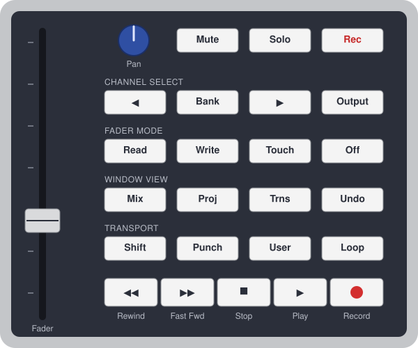

# 4irmann's FaderPort Driver for Bitwig Studio: Manual

Version 1.0.0. Copyright 2010-2026 Matthias Ehrmann (aka 4irmann), Apache License 2.0.

Based on the manual of the Renoise driver v1.1.0 (reviewed 2010 by Organic IO) and the REAPER driver v2.0.1.

*PreSonus and FaderPort are trademarks of PreSonus Audio Electronics, USA. Bitwig and Bitwig Studio
are trademarks of Bitwig GmbH. Renoise is a registered trademark of the Renoise makers. REAPER is a
trademark of Cockos Incorporated.*

---

## Contents

1. [Introduction](#introduction)
2. [Installation](#installation)
3. [Control overview](#control-overview)
4. [Controls in detail](#controls-in-detail)
5. [Modes in detail](#modes-in-detail)
6. [Automation and fader modes](#automation-and-fader-modes)
7. [Preferences](#preferences)
8. [Troubleshooting](#troubleshooting)
9. [Differences from the Renoise and REAPER drivers](#differences-from-the-renoise-and-reaper-drivers)
10. [Developer information](#developer-information)
11. [History](#history)

---

## Introduction

Hi :-), this is the manual for "4irmann's FaderPort Driver for Bitwig Studio". For those who don't
know the FaderPort, here is an excerpt from the official PreSonus manual:

> "The FaderPort is a powerful and affordable USB DAW controller. Featuring the same ultra
> high-quality Alps fader that is used in professional control surfaces and digital mixing
> consoles, the FaderPort utilizes a dual servo motorized drive belt system for fast-acting,
> accurate, and smooth operation. The FaderPort's 100 mm long throw fader delivers 1024-step
> resolution for writing ultra-fine and accurate fades and adjustments."

This driver supports the **classic FaderPort** (single fader, 2010 model). It does not support the
FaderPort 2/8/16.

### What's so special about the FaderPort?

Admittedly, it has only one fader, one pan control and some buttons. What makes it special is its
touch-sensitive ALPS motor fader with 10-bit resolution (1024 values). Mixing consoles that cost
thousands of dollars use the same fader.

Standard DAW controllers have a well-known problem. You set a track's volume with controller fader 1,
then change the volume with the mouse, and the fader no longer matches the DAW. A motor fader solves
this: the DAW sends its value back to the fader, and the knob moves "magically" to the new position.
That only helps if the fader moves precisely, quickly and quietly. The FaderPort's fader does all
three, and a long throw allows finer adjustments than a short one.

My conclusion: one high-quality fader that you can really use is better than 24 low-quality ones.
Such a fader is very worthwhile for mixing and for creating automation. That makes the integration
into the DAW all the more important.

### Why this driver?

Bitwig Studio ships drivers for the FaderPort 8 and FaderPort 16, but **none for the classic
FaderPort**. This driver comes from my Renoise driver (2010-2014) and its REAPER port. It brings
the same feature set to Bitwig:

- **Speed-sensitive pan encoder**: the faster you turn it, the larger the steps
- **Anti-suck protection** against the bouncing values of worn pan encoders
- **DSP mode**: fader and pan control the remote controls of the selected device, two at a time
- **Sticky mode**: the binding stays on one track/device (Bitwig's pinning)
- **Fine trim** via shift+pan, **fader/pan swap**, **reset to default** via rewind+forward
- Bitwig's **touch/latch/write** automation, with latch as the default write mode
- **Footswitch** support for hands-free recording

### Features

- all FaderPort buttons, the touch-sensitive motor fader, the endless pan encoder and all lights
- 10-bit fader resolution (1024 steps) with Bitwig's own volume fader curve
- endless pan control with speed feature, adjustable virtual resolution (default 128 steps),
  automatic down-scaling for discrete parameters, snap to center and adjustable anti-suck protection
- transport: play/stop, continue playback, stop, record, arranger loop, punch in/out, rewind/fast
  forward, cue marker navigation, moving the loop region, metronome
- track: mute, solo, arm, previous/next track, master track
- the selected track is bound to the FaderPort automatically
- DSP mode: the selected device is bound automatically; devices, remote control pages and parameter
  pairs can be selected on the FaderPort
- automation: touch, latch, write with real touch gestures from the motor fader
- bidirectional communication for all controls and lights
- undo/redo, mix/arrange layout, mixer and device panels
- one extension file for Windows, macOS and Linux

---

## Installation

### Requirements

- **Bitwig Studio 5.3 or later** (controller API 20). Developed with Bitwig Studio 6.0.
- a FaderPort MIDI driver: the FaderPort is a class-compliant USB MIDI device. Windows and macOS
  usually need no extra driver; PreSonus offers one for Windows. Linux uses the standard ALSA USB MIDI driver.
- optional, but strongly recommended: the FaderPort's **additional power supply**. Without it the
  fader motor and the touch detection don't work; see [Additional power supply](#additional-power-supply).

| Platform | Extension | Tested with Bitwig and hardware |
|---|---|---|
| Windows 10/11 | `FaderPort4irmann.bwextension` and installer | in progress |
| macOS | `FaderPort4irmann.bwextension` (same file) | **no** |
| Linux | `FaderPort4irmann.bwextension` (same file) | **no** |

Feedback is very welcome, either as a
[GitHub issue](https://github.com/4irmann/bitwig-faderport-driver/issues) or a comment.

### Windows installer

1. Download `bitwig-faderport-driver-<version>-setup.exe` from the
   [releases page](https://github.com/4irmann/bitwig-faderport-driver/releases).
2. Close Bitwig Studio and run the installer. No administrator rights are needed.
3. Check the Bitwig user folder. The installer suggests `Documents\Bitwig Studio`. If you moved it in
   Bitwig (Settings → Locations), select that folder. The extension goes to its `Extensions` subfolder.
4. Start Bitwig and add the controller, see [Adding the controller in Bitwig](#adding-the-controller-in-bitwig).

To uninstall, use Windows Settings → Apps → "4irmann's FaderPort Driver for Bitwig Studio". This
removes the extension, the manual and the uninstaller itself.

### Manual installation (all platforms)

Copy `FaderPort4irmann.bwextension` from the release to the `Extensions` folder of your Bitwig user folder:

| Platform | Extensions folder (default) |
|---|---|
| Windows | `%USERPROFILE%\Documents\Bitwig Studio\Extensions\` |
| macOS | `~/Documents/Bitwig Studio/Extensions/` |
| Linux | `~/Bitwig Studio/Extensions/` |

Bitwig picks up new or changed extensions automatically. If a controller already uses the extension,
switch the controller off and on again in Settings → Controllers.

### Adding the controller in Bitwig

1. Connect the FaderPort (with power supply).
2. Open Settings → Controllers. Bitwig usually detects the FaderPort automatically and proposes
   **FaderPort Classic (4irmann)**.
3. Otherwise click *Add controller* → **PreSonus** → **FaderPort Classic (4irmann)**, and select the
   FaderPort as MIDI input and output. On Linux the ports are often called "FaderPort MIDI 1".
4. Bitwig shows "FaderPort (classic) initialized", and the FaderPort's lights now reflect Bitwig.

Don't use the entries **FaderPort 8** or **FaderPort 16**; they are Bitwig's drivers for the newer
models. Only one controller may use the FaderPort's MIDI ports.

### Building it yourself

Requirements: JDK 17 or later and Maven 3.9.

```sh
git clone https://github.com/4irmann/bitwig-faderport-driver.git
cd bitwig-faderport-driver
mvn package
```

The result is `target/FaderPort4irmann.bwextension`, copy it to the `Extensions` folder. The build runs
the unit tests. The Windows installer is built with Inno Setup, see the [README](README.md#build).

---

## Control overview

<p align="center"></p>

The button labels are those of the hardware (schematic drawing, not to scale).

### Transport

| Button(s) | Action |
|---|---|
| Play | start/stop playback |
| Shift+Play | continue playback from where it stopped |
| Footswitch | start/stop playback |
| Stop | stop; pressed again, Bitwig returns to the play start position |
| Record | arranger record on/off |
| Rewind | rewind |
| Fast Fwd | fast forward |
| Shift+Rewind | previous cue marker |
| Shift+Fast Fwd | next cue marker |
| Loop | arranger loop on/off |
| Punch | punch in and punch out on/off |
| Shift+Punch | move the loop region left by its length |
| Shift+User | move the loop region right by its length |

### Window view

| Button(s) | Action | Notes |
|---|---|---|
| Mix | switch between the MIX and ARRANGE layout | light on in the MIX layout |
| Shift+Mix | show/hide the mixer panel | |
| Proj | ARRANGE layout | light on in the ARRANGE layout |
| Shift+Proj | show/hide the device panel | |
| Trns | sticky mode on/off | see [Sticky mode](#sticky-mode) |
| Shift+Trns | metronome on/off | |
| Undo | undo | |
| Shift+Undo | redo | |

In the original PreSonus layout, Trns opens the DAW's transport window. Bitwig has no separate
transport window, so Trns keeps the sticky mode of the Renoise driver. Shift+Trns toggles the
metronome, as in PreSonus' Cubase integration.

### Mixer (default mode)

| Button(s) | Action | Notes |
|---|---|---|
| Fader | track volume | controls swapped: track pan |
| Pan | track pan | controls swapped: track volume |
| Shift+Pan | fine trim of the fader parameter | |
| User | swap/unswap fader and pan control | light on while swapped |
| Shift+Loop | show the current binding in a popup | |
| Mute | mute/unmute selected track | in master mode: master track |
| Solo | solo/unsolo selected track | not in master mode |
| Rec | arm on/off for the selected track | not in master mode |
| ◀ / ▶ | select previous/next track | also leaves master mode |
| Output | master mode on/off: fader and pan control the master track | light on in master mode |
| Rewind+Fast Fwd | reset the fader parameter to its default (volume 0 dB, pan center) | |
| Bank | DSP mode on/off | see [DSP mode](#dsp-mode) |

### DSP mode (remote controls)

| Button(s) | Action | Notes |
|---|---|---|
| Fader | remote control 1, 3, 5 or 7 of the current pair | |
| Pan | remote control 2, 4, 6 or 8 of the current pair | |
| ◀ / ▶ | previous/next pair | continues on the previous/next remote controls page, wraps around |
| Shift+◀ / Shift+▶ | previous/next device | starts with the first pair |
| User | swap/unswap fader and pan control | |
| Shift+Pan | fine trim of the fader parameter | |
| Shift+Loop | show the current binding in a popup | |
| Rewind+Fast Fwd | reset the fader parameter to its default value | works for device parameters too |
| Bank | back to mixer mode | |

### Fader mode (automation)

| Button(s) | Action | Notes |
|---|---|---|
| Read | stop writing automation, give overridden parameters back to their automation | light on whenever no automation is written |
| Touch | automation write on, mode "touch"; pressed again: off | |
| Write | automation write on, mode "latch"; pressed again: off | default, see [Preferences](#preferences) |
| Shift+Write | automation write on, mode "write"; pressed again: off | |
| Off | as long as it is pressed, the FaderPort sends no fader values | doesn't change the automation mode |

The lights also follow changes you make in Bitwig itself, for example with the automation buttons
in the transport bar.

---

## Controls in detail

### Fader

The FaderPort sends the touch state and a value between 0 and 1023 whenever you touch or move the
fader. The driver sets the parameter bound to the fader to this value. The other direction works the same
way: as soon as the parameter changes in Bitwig (mouse, automation playback, another controller), the
motor moves the fader to the new position.

Bitwig's values are normalized, and track volume uses Bitwig's own fader curve. The fader therefore
behaves like Bitwig's mixer fader, from -inf dB to Bitwig's maximum. The scale is not linear: near the
bottom a small movement changes the volume more than around 0 dB.

Fader and parameter can't always be in perfect sync. The fader knows 1024 positions, while Bitwig uses
finer values. Touching the fader can therefore make the value "micro-jump" a little. In practice this is
no problem. For really fine adjustments use the fine trim, which works in steps of 1/2000 (see
[Fine trim](#fine-trim)).

The resolution of 1024 steps is a limit of the FaderPort hardware and its MIDI protocol.

Mechanical note: near the ends (0 and 1023) the motor doesn't move the knob completely to the end
stop. To reach the extreme values, push the knob all the way.

Discrete parameters (switches, selection lists) are quantized to their steps.

### Pan control

#### Endless encoder

The pan control is an endless encoder without touch detection. It sends only relative signals:
"one step left" or "one step right". The driver translates them into absolute parameter values with a
**virtual pan control**. If the parameter changes in Bitwig, the virtual pan control follows.

#### Resolution

The virtual pan control has 128 steps by default. For more precision raise the preference
*Pan resolution (steps)*, for example to 256 or 1024. The pan encoder has no hardware limit here.

For discrete parameters (switches, selection lists) the driver lowers the resolution to the number of
steps automatically. With a resolution of 20 steps or less, the speed feature is switched off. One click
then means one step.

#### Speed feature

The faster you turn the encoder, the larger the value change (speed 1 to 20 per step). This is the
Renoise driver's ballistics: speed = 1 + 0.2 s / interval between two steps. The driver measures the
interval between two encoder steps as they arrive.

#### Fake touch/release

The encoder doesn't report when you let go of it. The driver starts a touch gesture with the first step
and treats the encoder as released when no new value has arrived for 0.5 seconds. Bitwig uses this for
touch and latch automation.

#### Snap to center

For track and master pan, the driver snaps the value exactly to the center when it comes close.

#### Anti-suck protection

The pan encoder of my FaderPort sometimes sends wildly wrong values, or "flutters" between values.
The anti-suck protection filters this out. It counts the encoder clicks in one direction, and only
after *Pan anti-suck (clicks per step)* clicks (default 3) does the virtual value change.

If your encoder works more precisely than mine, lower the value to 2 or 1. A lower value gives a faster
response, but also more errors.

### Fine trim

With Shift held, the pan encoder doesn't change the pan parameter. Instead it fine-tunes the
**fader parameter** in steps of 1/2000 of its range, with the speed feature and anti-suck protection.
The motor fader follows.

### Swapping fader and pan control

The User button swaps the parameters of fader and pan control. You can then set pan precisely with the
motor fader, or the second parameter of a pair. The User light is on while the controls are swapped.

### Reset to default value

Press Rewind and Fast Fwd at the same time to reset the fader parameter to Bitwig's default value:
volume 0 dB, pan center, device parameters their device default.

### Footswitch

You can connect a standard footswitch (for example Korg PS-1) to the FaderPort. It starts and stops
playback, which is very helpful for hands-free recording. Some footswitches send "0" when pressed and
"1" when released. In that case set *Footswitch pressed signal* to 0.

### Popups

When you change the binding with the FaderPort (track or device navigation, DSP mode, master mode,
swap, sticky mode), Bitwig shows a popup with the new binding:

```
Bass / EQ+ / Page 1   ^Low Freq   >Low Gain
```

`^` marks the fader parameter and `>` the pan parameter. Shift+Loop shows the binding at any time. With
the preference *Show value changes*, every value change made with the FaderPort shows a popup too.

---

## Modes in detail

### Mixer mode

After start, the driver is in mixer mode. The fader controls the volume and the pan encoder the pan of
Bitwig's **selected track**. Selecting another track in Bitwig, with the mouse or with ◀/▶ on the
FaderPort, changes the binding. With the power supply connected, the motor moves the fader to the new
track's volume.

**Master mode** (Output button, light on) binds fader and pan to the master track. Mute then works on
the master track; Solo and Rec are not available. ◀/▶ leaves master mode.

### DSP mode

Bank switches DSP mode on (Bank light on). Fader and pan then control a **pair of remote controls** of
the selected device:

- **Device:** Bitwig's selected device on the selected track (the device the device panel shows).
  Shift+◀/▶ selects the previous/next device.
- **Remote controls:** every Bitwig device provides remote control pages with 8 parameters each. The
  driver binds them pairwise: (1,2), (3,4), (5,6), (7,8).
- **Navigation:** ◀/▶ selects the previous/next pair. After the last pair of a page, ▶ continues with the
  first pair of the next page; after the last page it wraps to the first.

Unlike in the Renoise and REAPER drivers, there is no binding list: the remote control pages take its
place. For Bitwig's own devices they are predefined. For plugins, define your own pages in Bitwig's device
panel (remote controls section → edit). The pages then work on the FaderPort as well.

A pair whose remote control slot is unassigned binds nothing to that control.

### Sticky mode

Normally the binding follows Bitwig's selection. Sometimes that is not what you want, for example when you
adjust one track while selecting others. **Trns** makes the binding *sticky*:

- In mixer mode, Trns pins Bitwig's cursor track. In DSP mode, it pins the cursor device.
- The Trns light shows the pin state of the current mode.
- This is Bitwig's own pinning. Pinning or unpinning in Bitwig's UI is reflected on the FaderPort.
- Press Trns again to unpin.

---

## Automation and fader modes

Bitwig writes the automation itself. The driver only sends **touch gestures**: the motor fader reports
touch and release exactly (with power supply), and the pan encoder uses
[fake touch/release](#fake-touchrelease).

**Important:** in Bitwig the automation write mode is **global**. The mode buttons switch Bitwig's arranger
automation write for all tracks, not a per-track mode as in REAPER. Bitwig always reads existing
automation, so there is no separate "read" mode to switch on.

| Mode | Before the control is touched | While touched | After release |
|---|---|---|---|
| **Read** (no writing) | automation is read, motor follows | value change overrides the automation temporarily | Read gives overridden parameters back to their automation |
| **Touch** | automation is read | **writes** | automation is read again |
| **Latch** (Write button) | automation is read | **writes** | **keeps writing** the last value until playback stops |
| **Write** (Shift+Write) | **writes** from playback start | **writes** | **writes** |

Pressing the active mode button again switches writing off. Write mode overwrites existing automation as
soon as playback runs. Don't forget to switch it off after recording.

The preference *Write button* defines whether the Write button means Latch (default) or Write.
Shift+Write then gives the other mode.

### Touch detection

- **With the power supply** the FaderPort reports touch and release of the fader exactly.
- **Without the power supply** there are no touch messages. The driver starts the gesture with the first
  fader value and ends it when no value has arrived for 0.3 seconds.
- The pan encoder never reports touch; see [Fake touch/release](#fake-touchrelease).

### The Off button

As long as Off is pressed, its light is on and **the FaderPort itself sends no fader values**. Use it to
move the fader to a new position without writing anything, for example in write mode. Releasing the
button switches the light off; the automation mode is not affected. (This behaviour is built into the
hardware. The driver therefore never switches the Off light on by itself.)

### Additional power supply

Connect the FaderPort's additional power supply when you work with the fader or with automation. Without
it the motor doesn't move and the fader can't follow automation playback. Touch detection is missing as
well. Writing values still works.

---

## Preferences

Settings → Controllers → **FaderPort Classic (4irmann)**. Bitwig saves the settings itself.

| Setting | Default | Description |
|---|---|---|
| Write button | Latch (Shift: Write) | which mode the Write button selects without Shift |
| Pan resolution (steps) | 128 | resolution of the virtual pan control |
| Pan anti-suck (clicks per step) | 3 | encoder clicks per step (1 = fastest, more errors) |
| Footswitch pressed signal | 1 | 0 for footswitches with reversed wiring |
| Show value changes | off | popup for every value change made with the FaderPort |
| Dump MIDI to console | off | print all FaderPort MIDI messages to the controller script console |

The MIDI dump is printed to Bitwig's **Control Script Console**, which Bitwig provides for
controller extensions.

---

## Troubleshooting

| Problem | Solution(s) |
|---|---|
| Bitwig reports "This cannot be called when specifying required API version …" | You have an old build of the extension. Install the current version; it requires Bitwig Studio 5.3 or later. |
| The extension doesn't appear under *Add controller* | Check that `FaderPort4irmann.bwextension` is in the `Extensions` folder of your Bitwig user folder (Settings → Locations), and that your Bitwig version is 5.3 or later. |
| FaderPort doesn't react | Check USB and power supply, and unplug/replug USB. In Settings → Controllers, check that the FaderPort is selected as MIDI input **and** output, and that no other controller (for example "FaderPort 8") uses it. Switch the controller off and on again. |
| Fader motor doesn't move | Connect the additional power supply. |
| Fader sends values without being moved | Can happen without power supply (motor off). Connect the power supply. |
| Pan encoder jumps or bounces | Raise *Pan anti-suck*. |
| Pan is too slow | Lower *Pan anti-suck*; turn faster (speed feature). |
| FaderPort crashes when the pan encoder is turned very slowly | A FaderPort firmware bug. Switch the controller off and on again in Settings → Controllers. |
| DSP mode binds nothing | No device is selected, or the remote control slots of the current page are unassigned. Select a device, or define remote control pages for the plugin in Bitwig's device panel. |
| Writing automation affects other tracks | Expected: Bitwig's automation write mode is global. Switch writing off with Read. |
| The motor fader doesn't follow automation | Write mode is on, or the parameter is overridden. Press Read. |

---

## Differences from the Renoise and REAPER drivers

| Renoise / REAPER | Bitwig |
|---|---|
| DSP binding list (`config.xml` / `bindings.lua` / `bindings.txt`) | remote control pages of the device, pairwise |
| device info dialog / "Show FX parameters" action | Bitwig's device panel shows the remote controls |
| per-track automation mode (REAPER) | global automation write mode |
| own sticky logic | Bitwig's pinning of cursor track and cursor device |
| Output = pre/post mixer (Renoise) / master track (REAPER) | master mode |
| Proj = pattern editor (Renoise) / FX chain (REAPER) | ARRANGE layout; Shift: device panel |
| Rewind/Fwd = sequence steps / markers | rewind/fast forward; Shift: cue markers |
| Stop while stopped = panic | Stop again = back to the play start position (Bitwig) |
| Reset to default not possible for FX parameters (REAPER) | works for all parameters |
| emulator window | not available: Bitwig extensions can't open windows |
| status line (Renoise/REAPER) | Bitwig popup notifications |

---

## Developer information

The source code is at https://github.com/4irmann/bitwig-faderport-driver.

- `core/Driver` contains the driver logic (buttons, fader, pan/trim ballistics, lights). It is a port of
  the REAPER driver and knows Bitwig only through the `Daw` and `Param` interfaces.
- `BitwigDaw` and `BitwigParam` implement these interfaces with the Bitwig controller API. Every value the
  driver reads is marked as interesting, and observers request a flush.
- `FaderPortExtension` wires MIDI, preferences, Bitwig's `flush()` and a 50 ms tick (release timeouts).
- Unit tests: `mvn test`, against a fake `Daw`, no Bitwig needed.
- The extension is compiled against `com.bitwig:extension-api:25` and declares API 20. Bitwig refuses calls
  to functions that are newer than the declared version, so check the "Since" of new API calls in the API
  documentation. Bitwig installs it locally, on Windows in
  `C:\Program Files\Bitwig Studio\resources\doc\control-surface\api\index.html`.

### Debugging

Enable *Dump MIDI to console* and open the controller script console. All FaderPort MIDI messages are
printed there.

### FaderPort MIDI chart (native mode)

The driver switches the FaderPort to native mode with `0x91 0x00 0x64`. To change the button mapping, see
`onButton()` in `core/Driver.java`.

**Host → FaderPort (lights, motor):**

| Message | Description |
|---|---|
| `0xa0 0x00 0/1` | Record light |
| `0xa0 0x01 0/1` | Play light |
| `0xa0 0x02 0/1` | Stop light |
| `0xa0 0x03 0/1` | Fast Fwd light |
| `0xa0 0x04 0/1` | Rewind light |
| `0xa0 0x05 0/1` | Shift light |
| `0xa0 0x06 0/1` | Punch light |
| `0xa0 0x07 0/1` | User light |
| `0xa0 0x08 0/1` | Loop light |
| `0xa0 0x09 0/1` | Undo light |
| `0xa0 0x0a 0/1` | Trns light |
| `0xa0 0x0b 0/1` | Proj light |
| `0xa0 0x0c 0/1` | Mix light |
| `0xa0 0x0d 0/1` | Read light |
| `0xa0 0x0e 0/1` | Write light |
| `0xa0 0x0f 0/1` | Touch light |
| `0xa0 0x10 0/1` | Off light, **switching it on disables the fader!** |
| `0xa0 0x11 0/1` | Output light |
| `0xa0 0x12 0/1` | Channel select right light |
| `0xa0 0x13 0/1` | Bank light |
| `0xa0 0x14 0/1` | Channel select left light |
| `0xa0 0x15 0/1` | Mute light |
| `0xa0 0x16 0/1` | Solo light |
| `0xa0 0x17 0/1` | Rec light |
| `0xb0 0x00 v>>7`, `0xb0 0x20 v&0x7f` | motor fader position v (0..1023) |
| `0x91 0x00 0x64` | switch to native mode / reset |

**FaderPort → host (buttons, fader, pan):**

| Message | Description |
|---|---|
| `0xb0 0x00 msb`, `0xb0 0x20 lsb` | fader value = msb<<3 \| lsb>>4 (0..1023) |
| `0xe0 0x00 0x01` / `0x7e` | pan encoder one step right / left |
| `0xa0 0x7f 0/1` | fader touched/released (only with power supply) |
| `0xa0 0x7e 0/1` | footswitch |
| `0xa0 0x00 0/1` | User |
| `0xa0 0x01 0/1` | Punch |
| `0xa0 0x02 0/1` | Shift |
| `0xa0 0x03 0/1` | Rewind |
| `0xa0 0x04 0/1` | Fast Fwd |
| `0xa0 0x05 0/1` | Stop |
| `0xa0 0x06 0/1` | Play |
| `0xa0 0x07 0/1` | Record |
| `0xa0 0x08 0/1` | Touch |
| `0xa0 0x09 0/1` | Write |
| `0xa0 0x0a 0/1` | Read |
| `0xa0 0x0b 0/1` | Mix |
| `0xa0 0x0c 0/1` | Proj |
| `0xa0 0x0d 0/1` | Trns |
| `0xa0 0x0e 0/1` | Undo |
| `0xa0 0x0f 0/1` | Loop |
| `0xa0 0x10 0/1` | Rec |
| `0xa0 0x11 0/1` | Solo |
| `0xa0 0x12 0/1` | Mute |
| `0xa0 0x13 0/1` | Channel select left |
| `0xa0 0x14 0/1` | Bank |
| `0xa0 0x15 0/1` | Channel select right |
| `0xa0 0x16 0/1` | Output |
| `0xa0 0x17 0/1` | Off |

Light numbers and button numbers differ.

### Regression tests

Besides the unit tests, these manual checks should be run with real hardware before a release, with and
without the power supply.

| Test | Expected result |
|---|---|
| Bitwig start, FaderPort connected | "FaderPort (classic) initialized", lights reflect Bitwig, fader moves to the volume of the selected track |
| switch the controller off in Settings → Controllers | all FaderPort lights off |
| select tracks quickly (mouse and ◀/▶) | fader follows each track |
| move fader and pan at the same time | both values change |
| volume automation during playback, nothing written | motor follows the automation |
| Touch/Latch/Write during playback, with and without power supply | automation is written as described in [Automation and fader modes](#automation-and-fader-modes) |
| Off pressed while moving the fader in Write mode | no new values are written |
| DSP mode, iterate pairs across pages back and forth | continues on the next/previous page, wraps around |
| DSP mode with a plugin without remote control pages | nothing bound, no error |
| Trns in mixer and DSP mode, pin/unpin in Bitwig's UI | pin state and Trns light match |
| Rewind+Fast Fwd on volume and on a device parameter | both reset to their default |
| install/uninstall with the Windows installer | extension in `Extensions`, uninstall removes it |

---

## History

- **v1.0** (2010): initial Renoise release, tested with Renoise 2.6 RC2
- **v1.0.1**: bugfix release, manual reviewed by Organic IO
- **v1.0.2**: Renoise 2.7; Output toggles post-fx/pre-fx mixer
- **v1.1.0** (2014): Renoise 3.0; MIDI-mappable emulator, reorganized menus and bindings
- REAPER driver v2.0.0/v2.0.1 (2026): port to REAPER, see
  [reaper-faderport-driver](https://github.com/4irmann/reaper-faderport-driver)
- **Bitwig driver v1.0.0** (2026): port to Bitwig Studio as a Java controller extension; remote control
  pages, pinning, Bitwig's touch automation, Windows installer
